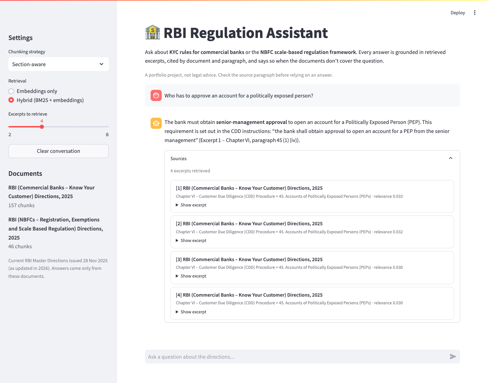

# RBI Regulation Assistant (RAG)

Question answering over current Reserve Bank of India Master Directions, with
every answer grounded in retrieved excerpts and cited by document and
paragraph. Built to show the parts of RAG that usually get skipped: measuring
retrieval at the passage level, comparing chunking and retrieval strategies
with numbers, and noticing when the corpus itself goes out of date.

**Live demo:** https://regulatory-rag-assistant-g8pv5qvhhtguovlbk9ihd8.streamlit.app  
**Write-up:** [writeup.md](writeup.md)



## Corpus
14 current Master Directions (about 830 pages), all issued 28 Nov 2025 and
several updated during 2026:

| Commercial banks | Pages | NBFCs | Pages |
|---|---|---|---|
| Know Your Customer | 101 | Registration, Exemptions and Scale Based Regulation | 31 |
| Responsible Business Conduct (fair practices, recovery agents, service charges) | 161 | Responsible Business Conduct | 36 |
| Credit Facilities (includes digital lending and DLG) | 153 | Know Your Customer | 96 |
| Credit Cards and Debit Cards: Issuance and Conduct | 34 | Income Recognition, Asset Classification and Provisioning | 26 |
| Interest Rates on Advances | 20 | Microfinance Institution | 19 |
| Interest Rate on Deposits | 25 | | |
| Income Recognition, Asset Classification and Provisioning | 52 | | |
| Treatment of Wilful Defaulters and Large Defaulters | 30 | | |
| Managing Risks in Outsourcing | 44 | | |

Since the consolidation the RBI issues a separate direction per type of
regulated entity, and the bank and NBFC versions often share wording (both KYC
directions require high-risk customers' KYC to be refreshed every two years).
Every chunk is tagged with its entity, and retrieval can be limited to one.

The project started with two directions and grew to 14; the eval results below
show what that did to retrieval. The first version used six 2021–2025 circulars. Every page of them turned out to
be stamped *Withdrawn*: the RBI's 28 Nov 2025 consolidation replaced 9,445
circulars with 244 Master Directions. They're kept in `data/withdrawn/` (with
their old eval set and results) but no longer ingested.

## How it works
```
data/raw/*.pdf ─► src/ingest.py ─► clean text ─► chunk ─► embed (MiniLM) ─► ChromaDB
                                                                              │
question ─► src/query.py ─► dense search + BM25 ─► reciprocal rank fusion ─► top 4
                                                                              │
                         Groq (gpt-oss-120b) ◄─ excerpts + "answer only from these, cite them"
                                │
                 src/api.py (FastAPI)  ·  frontend/app.py (Streamlit)
```
- **Text cleanup:** drops watermarks, page numbers, table-of-contents lines and
  garbled Hindi letterheads; repairs pypdf's split words and line-wrap hyphens.
- **Section-aware chunking** (default): splits on chapter / lettered section /
  numbered paragraph boundaries, packs whole paragraphs into chunks of at most
  300 words without crossing a heading, and prefixes each chunk with its
  location, e.g. `[Chapter VI – Customer Due Diligence > 42. Updation / Periodic Updation of KYC]`.
- **Hybrid retrieval** (default): embeddings plus BM25 keyword search, merged
  with reciprocal rank fusion, which helps with exact terms like "NBFC-ICC" or "V-CIP".
- **Entity filter** (optional): limits both searches to bank or NBFC
  directions, and every excerpt tells the model which entity it applies to.

## Results

### Retrieval (`eval/run_eval.py`, no API key needed)
50 answerable questions across all 14 directions, each with a verbatim
evidence quote from its answering passage, plus 3 questions whose answers aren't
in the corpus. A retrieved chunk counts as a hit only if it contains the quote.
"Wrong-entity chunks" is the share of the top 4 that came from the other
entity type's directions.

| Strategy | Retrieval | Chunk hit rate (top 4) | Chunk MRR | Wrong-entity chunks |
|---|---|---|---|---|
| fixed_small (300 words) | dense | 64% | 0.50 | 10% |
| fixed_small (300 words) | hybrid | 70% | 0.57 | 17% |
| fixed_large (800 words) | dense | 36% | 0.26 | 14% |
| fixed_large (800 words) | hybrid | 54% | 0.39 | 16% |
| section | dense | 76% | 0.64 | 12% |
| **section** | **hybrid** | **82%** | **0.68** | 16% |
| section | hybrid + entity filter | 84% | 0.72 | 0% |

**Growing the corpus from 2 to 14 directions.** On the original 28 questions
the default configuration kept its 82% hit rate, but MRR fell from 0.78 to 0.69:
the answering passage still makes the top 4, just lower, behind look-alike
passages from other directions. Fixed 800-word windows lost the most (on those
28: dense 54% → 46%, hybrid 68% → 61%), since big chunks from 14 documents all
look vaguely relevant.

### Answer quality (`eval/run_ragas.py`, RAGAS 0.2.9)
Default configuration (section chunking, hybrid retrieval). Answers by
`gpt-oss-120b`, judged by `gpt-oss-20b` so the model doesn't grade itself.

| Corpus | Faithfulness | Context precision | Context recall | Questions scored |
|---|---|---|---|---|
| 2 directions | 0.91 | 0.81 | 0.89 | all 28 |
| 14 directions | in progress | | | 50 |

On the two-direction corpus all 3 out-of-corpus questions were declined rather
than guessed. RAGAS on the 14-direction corpus takes about three days of Groq's
free judge quota; `eval/run_ragas.py` resumes where it stopped
(`eval/ragas_results_2doc_corpus.json` keeps the earlier run).

### What the numbers say
- **Bank and NBFC rules blur together without a filter.** Unfiltered, one in
  six retrieved chunks comes from the wrong entity's directions; the filter
  removes them and lifts MRR from 0.68 to 0.72.
- **Passage-level scoring changes the picture.** On the old corpus, document hit
  rate was 100% while the answering passage was in the top 4 only 57% of the time.
- **Section-aware chunking wins on well-structured documents.** On the old,
  messier circulars it lost to 300-word windows; on the consolidated directions,
  with consistent chapter → section → paragraph numbering, it leads on both hit
  rate and rank.
- **Hybrid beats dense for every chunker.** Regulatory questions hinge on exact
  terms that BM25 catches and a small embedding model blurs.
- **Remaining misses are paraphrase gaps,** e.g. "shareholding" vs "controlling
  ownership interest", or "what test decides the Upper Layer" vs a one-line
  asset-size rule. Acronym-only phrasing is weaker too: "What NOF does an
  infrastructure finance company need?" misses the paragraph that "minimum net
  owned fund" ranks first. A reranker and acronym expansion are the next steps.

### Caveats
- I wrote the questions after reading the documents, which flatters retrieval.
- 50 questions: differences of a few points are noise.
- Citations can be off by a sub-clause (e.g. 45(1)(iv) for a rule in 45(1)(iii)):
  check the excerpt, which the UI shows under every answer.
- Groq's free tier (8k tokens/min, 200k tokens/day per model) limits how much
  RAGAS can run per day.

## Run it
Needs Python 3.12 (the pinned torch/chromadb/pandas don't support 3.14 yet).
```bash
python3.12 -m venv venv && source venv/bin/activate
pip install -r requirements.txt
cp .env.example .env                 # add a free Groq key: https://console.groq.com/keys

python src/ingest.py --strategy all  # build every strategy's index
streamlit run frontend/app.py        # UI (builds the default index itself if missing)
uvicorn src.api:app --reload         # API: localhost:8000/docs
python src/query.py "How often must a bank update KYC for a high-risk customer?"

python eval/run_eval.py              # retrieval, every strategy x retrieval mode
python eval/run_ragas.py --strategy section   # answer quality (needs GROQ_API_KEY)
```

### API
`POST /ask` with `{"question": "...", "strategy": "section", "mode": "hybrid", "top_k": 4, "entity": "bank"}`
(all but `question` optional; `entity` is `bank` or `nbfc`) returns the answer
plus each source's document, entity, section, score and text. `GET /sources` lists the indexed documents. Bad input
returns 422, a missing index 503, an LLM failure 502. Set `CORS_ORIGINS` to
restrict which sites can call it.

### Adding documents
Add `(pdf_link, slug)` pairs to `scripts/download_sources.py` and run it. RBI's
server often drops scripted requests; if so, save the PDFs from a browser and
run `python scripts/download_sources.py --from-dir ~/Downloads`. Then add
questions with evidence quotes to `eval/qa_set.json`; `run_eval.py` warns about
any quote it can't find in the corpus.

## Deploy
- **Streamlit Community Cloud** (used for the demo, free): New app → this repo,
  branch `main`, main file `frontend/app.py`, Python 3.12, and `GROQ_API_KEY`
  under Advanced settings → Secrets. The app builds its index on first start.
- **Docker:** `docker build -t rbi-rag . && docker run -p 7860:7860 -e GROQ_API_KEY=... rbi-rag`
  (the index is built into the image). `scripts/deploy_hf_space.py` pushes the
  same image to a Hugging Face Docker Space, which now needs a PRO account.
- **Render:** `render.yaml` builds the index during the build and serves the API.

## Stack
sentence-transformers (`all-MiniLM-L6-v2`), ChromaDB, rank-bm25, Groq
(`openai/gpt-oss-120b` answers, `openai/gpt-oss-20b` as the RAGAS judge so the
model doesn't grade itself), RAGAS 0.2.9, FastAPI, Streamlit.
